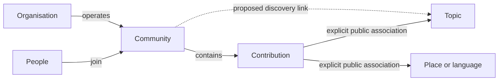

# ETNOS: understandable spaces and first-account onboarding

**Follow-up:** the owner subsequently selected open signup through Bluesky. The provider-started enrollment described as a next step below is now implemented; see [signup and sandpile delivery](signup-and-sandpile-2026-11-04.md) for current scope and release evidence. Optional handle claiming and community/topic assignment remain separate.

Research and implementation note · 4 November 2026. Exa reviewed 38 search results across seven angles (PieFed discovery, ATProto groups, Cloudflare limits, identity signup, custom handles, wildcard routing and alternative providers). Firecrawl retrieved current first-party plan and account-flow documentation. Search hits were treated as leads, not as proof; links below identify the primary evidence used. No donor application code was copied.

## The separation people should encounter

| Interface | What it means | Example and action | Authority |
| --- | --- | --- | --- |
| Komunitas | People gathering for ongoing conversation | A reggae community: join or request to join | Room owners/moderators, admission and visibility |
| Topik | Something conversations can be about across rooms | Musik Reggae: explore related public contributions | A curated discovery classification; no membership |
| Tempat & bahasa | Geographic or language associations | Jayapura or a public language index: filter/explore | Discovery association, never ethnicity, affiliation or admission |
| Organisasi | An accountable collective that can operate several rooms | A school with public notices and member coordination | Its own membership, operators and roles; no automatic government verification |

A topic and a community can share a name without being duplicates. “Reggae” answers what a contribution concerns. A reggae community has actual members, rules and moderators. Organisations can reuse community profile components, but merging their records would conflate operating an institution with joining one of its rooms.

An ordinary community can be the simple case (one room, its own moderators). An organisation is the richer case (one accountable collective, several rooms and responsibilities). Share visual components; retain the authority distinction. Existing room admission remains independent of parent-group membership.



The dotted community-to-topic link is a recommendation, not a feature added in this pass. The current engine links contexts to posts, groups, wiki and work; it does not yet have a direct community-context relation. The new topic pages collect explicitly linked public contributions. They do not claim that the directory already implements PieFed's community taxonomy. Topic follows, a posting/tagging picker, and community-topic assignment remain useful next steps.

Places, administrative boundaries, customary territories, languages and institutional remit overlap. Use typed, attributable links rather than a single ownership tree. A public language category is distinct from a protected corpus and from the BCP-47 language of an individual text. Never derive public discovery records from private room names, membership or source material.

## What this UI pass implements

- Topics have a separate directory entry and search/Explore grouping. Places/languages exclude `kind=topic`; the internal discriminated context record is retained rather than migrating identities or losing existing links.
- Four directory entries remain: communities, topics, places/languages and organisations. Followed communities becomes a filter within communities.
- Existing `/contexts/<slug>` links work. A topic detail identifies itself as Topik, without an extra back-label, a one-item navigation strip and repeated empty Percakapan heading.
- Topic creation is the existing steward-only public-context operation, with an appropriate title/type. This is not open taxonomy creation for every new account.
- Wiki review is available from a public post's menu to the existing eligible stewards. It opens a deliberate review/draft dialog; no model inference runs until explicitly requested, and no draft is published by opening it. Private posts and ordinary members retain the existing boundary. Real public-work relationships remain visible below a thread.
- Gabarito now pairs with official, self-hosted Geist Serif by default. The five font choices remain; Instrument Sans still loads its Instrument Serif pairing on demand.
- Explore's compact poll list retains interior row separators and one outer bottom divider.

These are UI projections over the existing model. No ATProto primitive called “topic membership” was invented, and no access-control or schema migration accompanies the naming cleanup.

## Which primitives actually come from ATProto

| Primitive | Use here | Qualification |
| --- | --- | --- |
| DID, handle and OAuth | Account identity and sign-in | Identity is not membership, human proof or institutional verification |
| Lexicon records and strong references | Typed public contributions and links | ETNOS defines app semantics; an internal type does not automatically become a network standard |
| Labels | Moderation judgments/provenance when deliberately adopted | Labels are not a private-data access-control system |
| Group DID, roles and modality-specific Spaces | Direction for portable group identity and permissioned app data | Open Social Groups/Spaces remains experimental; this pass does not switch protected storage to it |

[PieFed's user guide](https://join.piefed.social/docs/user-guide/) explicitly describes topics as an admin-curated hierarchy containing communities. [Its feeds](https://join.piefed.social/2025/04/30/how-piefed-federates-feeds-aka-multi-reddits-or-multi-comms/) are a separate user-created collection/subscription concept. The useful lesson is the distinction between a place to participate and a way to collect/discover it, not copying three overlapping navigation names.

[Atmospheric Groups](https://atproto.com/blog/atmospheric-groups-intro) and the [Open Social Groups proposal](https://tangled.org/opensocial.group/proposal/raw/main/proposal.md?download=1) distinguish group identity/roles from per-app Spaces and read grants. Group DIDs can outlive an individual operator; the host can issue credentials scoped to current roles. The [Spaces alpha warning](https://atproto.com/blog/atproto-spaces-alpha) still applies. Public reads are possible, and access control alone is not end-to-end encryption.

## Account creation: two independent admissions

Current ETNOS can authenticate an existing invited AT account. `src/oauth.ts` resolves the DID, checks its invitation both before redirect and at callback, verifies the browser-bound flow, and rejects service actors on the human path. Sessions recheck current allowlist membership. `POST /auth/invite` admits a known DID; it is not a pre-account invitation code or a self-service signup flow.

The existing login page links out to account creation and explains that this does not grant ETNOS enrollment. That works for a guided invited test, but is too awkward as the normal newcomer path.

[ATProto network account management](https://atproto.com/blog/network-account-management) supports beginning OAuth at a PDS without already knowing the user's handle. The provider can create the account, perform its checks and return to the app. An independent app does not need to send the person through the Bluesky app first. The [OAuth specification](https://atproto.com/specs/oauth) requires resolving the resulting DID and confirming that its PDS/authorization server matches the issuer; provider-started signup must keep that validation, browser state binding, PKCE, PAR and DPoP. Do not implement `prompt=create` merely because a discussion proposes it; negotiate capabilities of the chosen provider and current client library.

Recommended first implementation:

1. A bounded ETNOS invitation starts the flow before an account exists. Store a hash, expiry and remaining uses; bind its redemption to the browser's OAuth transaction. A code authorizes enrollment on this node, not private rooms, moderator powers or official affiliation.
2. Offer Masuk / Buat akun. A known allowed PDS can handle account creation and password/passkey recovery, then return to ETNOS. Show who hosts the account at the provider choice. ETNOS never receives the provider password. No arbitrary user-supplied provider URL or operator password is accepted.
3. After verified OAuth, atomically consume the invitation and enroll the DID. Handle retries with a durable redemption receipt; recheck expiry/revocation after external I/O. Preserve the separate service-agent path and disabled AT broadcasting.
4. Let the person choose display name and interface language; place/interests remain optional. Present a few actual public communities, respecting approval/invite policies. Do not silently join a private room or infer ethnicity, residence or institutional remit.
5. Add operator enrollment suspension/revocation controls and keep report/member-removal paths reachable. The current auth routes support inviting an existing account, but not a full newcomer invitation-code/approval/withdrawal UI.

This is a proposed next implementation, not an enabled registration endpoint. A provider-issued identity and ETNOS enrollment still do not grant cultural-room admission. The account provider's recovery and ETNOS's local encrypted-message vault recovery are different tasks.

Self-hosted accounts are a separate hosting project. The local [Strata PDS package](https://github.com/yohn-maistre/strata/tree/feat/connected-oauth/packages/pds) is still experimental and currently one identity per Cloudflare deployment. It has meaningful official-library/workerd/OAuth tests, but production recovery, grant management/revocation, load and snapshot qualification remain gates. Its [Cirrus upstream](https://github.com/ascorbic/cirrus) also describes itself as experimental beta. Do not use it as an unqualified mass-signup service. The [official PDS production guide](https://atproto.com/guides/going-to-production) calls out recovery keys, database backups, abuse responsibility, invite codes and relay signup limits.

## Can a pilot use Cloudflare Free?

A small pilot using an existing account provider is feasible within Free limits, subject to profiling; this is not a measured capacity promise or a claim that the current account is on Free.

| Resource | Current documented Free allowance/limit | Relevance |
| --- | --- | --- |
| Workers | 100,000 requests/day; 10ms CPU/invocation | Profile OAuth/crypto/routing CPU, not only wall time |
| SQLite Durable Objects | 100,000 requests/day; 13,000 GB-s/day | Avoid polling/long-lived work that prevents hibernation |
| DO SQLite | 5m rows read/day; 100k rows written/day; 5GB account total; 1GB per object | ETNOS currently has one node object, including local media; the per-object cap matters first |
| R2 Standard | 10GB-month, 1m Class A and 10m Class B operations/month; no internet egress charge | Separate service and allowance; not an automatic hard $0 cap, and not the current forum media backend |

Sources: [Workers pricing](https://developers.cloudflare.com/workers/platform/pricing/), [Durable Objects pricing](https://developers.cloudflare.com/durable-objects/platform/pricing/), [DO limits](https://developers.cloudflare.com/durable-objects/platform/limits/), [R2 pricing](https://developers.cloudflare.com/r2/pricing/), fetched for this pass. Worker static assets have free/unlimited asset requests, but current worker-first routing can still invoke the Worker before serving assets. DO CPU limits and outer Worker CPU limits are distinct. On Free, exhausted daily operations fail until reset; SQL capacity is not a monthly user-count allowance. Included limits are shared at the applicable account/service scope, including other projects.

The current Cloudflare OAuth connection cannot read account subscriptions: that endpoint requires Billing Read/Write and returns 403. No extra credentials were requested and no plan/billing changes were made. Feasibility above is based on official limits, not inferred from `usage_model=standard`.

Before a broader public opening, finish the provider-started invitation/enrollment path; complete an operator backup/restore and recovery exercise; measure realistic request/CPU/SQL/media use with a hard budget/abuse policy; rehearse report/member removal/enrollment withdrawal. The existing fourteen browser journeys and new taxonomy/menu journey are software evidence, not a disaster-recovery or physical-phone rehearsal. Community-topic links and a simple explicit topic picker are the next discovery feature; automated clustering and Aksara's scheduled rounds can follow under public-only, revocable mandates.

## Verification

Connected UI check/build and nine unit checks passed. The new loopback taxonomy journey passes at 320/390/768/1440px: topic/place separation, old links, typed search, empty-topic layout, topic creation/cancel, feed/thread wiki menu, native draft creation without publication, private/member denial, no implicit inference, and the poll list's single outer divider. All 15 browser journeys passed against the production build. Final label/duplicate-badge cleanup is followed by check/build and repeated taxonomy/governance checks before upload. Synthetic fixtures never seed a deployed node.

## ETNOS-domain handles on an existing provider

The owner selected an existing provider first, while asking for handles such as `giyaibo.etnos.space` and a route to larger hosting later. Account hosting, the domain handle, and the forum host are separate. An external PDS can hold the account while ETNOS operates the handle namespace. The stable DID, not the current handle or PDS URL, anchors local identity and membership.

For the pilot, one approved DNS TXT record per handle is the smallest service:

```text
_atproto.<name>.etnos.space TXT "did=<the verified account DID>"
```

No Worker invocation is needed for that DNS lookup. ETNOS already owns this active full Cloudflare zone; the zone API reports **Free Website**. This is evidence for the DNS part, not the unreadable Workers subscription. It adds no per-person domain registration. For greater scale, a narrowly routed HTTPS `https://<name>.etnos.space/.well-known/atproto-did` can return the mapped DID. [Cloudflare wildcard DNS](https://developers.cloudflare.com/dns/manage-dns-records/reference/wildcard-dns-records/) can be proxied on all plans. [Worker Routes](https://developers.cloudflare.com/workers/configuration/routing/routes/) require proxied DNS; they support wildcard host routing. [Universal SSL](https://developers.cloudflare.com/ssl/edge-certificates/universal-ssl/limitations/) covers first-level subdomains in a full zone. That does not cover arbitrary deeper institution/username hierarchies. A shared wildcard resolver is a future option, not deployed by this experiment.

The [ATProto handle specification](https://atproto.com/specs/handle) requires **both** the domain proof and the DID document's canonical handle to agree. Creating DNS alone must never authenticate an alias for someone else's account. The account owner must confirm the handle at the provider; confirming an AT handle changes that account's cross-app handle. Offer ETNOS-domain identity as an explicit public choice. A friendly ETNOS profile URL alone can be separate if someone wishes to keep their existing AT handle. Neither choice grants room or institutional authority.

A future claim registry should use a normalized/reserved single-label namespace, a transactional unique binding to the verified OAuth DID, an operator approval/receipt for DNS changes, and explicit states for pending/domain-ready/provider-confirmed. Reject conflicts; reconcile uncertain outward changes before retrying. Do not automatically recycle a name or revoke its global identity mapping merely because local participation was suspended. Government/organisation names need a separate authorization policy. The provider creates an identity outside ETNOS's transaction: enrollment failure cannot promise rollback or blindly retry that account creation.

The [migration guide](https://atproto.com/guides/account-migration) explains moving the same identity to another PDS using verified control, copied repository/blob data and an updated DID document. Keeping domain control and the same DID makes handle-service/provider changes possible; recovery keys/cooperative provider support and a real migration/restore rehearsal remain necessary. Moving ETNOS itself also requires a qualified database/media/auth export/import and production server adapter. The current development Node server is not a production OAuth replacement merely by changing DNS.

### Probe and qualification

- Created a disposable `_atproto.signup-probe.etnos.space` TXT record (TTL 60) on the actual Free zone, pointing only to the steward's already-public DID. A public Cloudflare DNS-over-HTTPS lookup returned the expected record. No account/PDS/DID write occurred.
- The official OAuth client's identity resolver rejected that unconfirmed alias because the live DID document still claims `giyaibo.bsky.social`. This is the expected anti-spoof result; the user's handle stayed unchanged.
- Removed the exact probe record after checking its name/content/ownership, then confirmed zero matching records in the zone. Recursive caches can retain an answer until TTL expiry; bidirectional validation still rejects it. No wildcard DNS, Worker route, domain purchase or billing plan was changed.
- Loopback tests use the actual official client and entirely intercepted identity/provider edges to check a confirmed custom handle, rejection of an unconfirmed alias, an invited custom-handle OAuth login, and a fresh PDS location lookup retaining the same DID/handle/local protected-room rights. Refreshing the resolver (`noCache`) matters during a known hosting change. These are provider-location simulations and an invited-login fixture, not a live PDS migration or an implemented pre-account signup flow.

Synthetic visual evidence: [topic directory](topics-2026-11-04/taxonomy-topics-390.png), [empty topic](topics-2026-11-04/taxonomy-empty-topic-390.png), [wiki review](topics-2026-11-04/taxonomy-wiki-review-390.png), [draft](topics-2026-11-04/taxonomy-wiki-draft-390.png).

### Provider candidates

[Eurosky](https://eurosky.tech/faq/) explicitly offers free accounts open globally, hosted in Europe. [Blacksky's hosting guide](https://docs.blacksky.community/info-about-blacksky-the-community/migrating-to-blacksky-pds-complete-guide) identifies general-use domains `myatproto.social` and `cryptoanarchy.network` alongside its community-specific `blacksky.app` namespace. These are candidate providers, not newly enabled ETNOS hosts: each issuer/discovery/OAuth callback and applicable signup/domain policy needs qualification before extending the current provider allowlist. Bluesky remains the initial practical default. A generic application using ATProto is not automatically a separate PDS provider.

The expected signup return is the provider's OAuth web interface → verified callback → ETNOS session. It does not require installing the Bluesky app. That pre-account enrollment path still needs implementation; the existing invited-login path has been tested with a custom-domain fixture. Full test/probe scope and 97 passing core checks are [recorded in Strata](https://github.com/yohn-maistre/strata/blob/feat/connected-oauth/docs/handle-portability-2026-11-04.md).

The UI portion is now deployed; [source/artifact receipt](topics-2026-11-04/README.md) records the final version, live checks and remaining signup scope. The same DID permits a hosting move after verified issuer discovery and provider-host qualification; the existing provider allowlist is not bypassed by choosing a custom domain.
